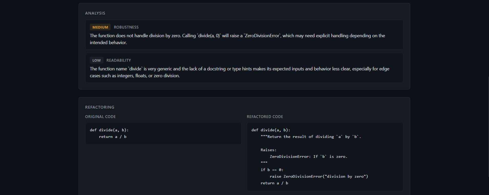

# AI Code Review Agent

An AI-powered multi-agent code review and refactoring system built with Python, FastAPI, Vue.js, and the OpenAI API.

The application analyzes source code, proposes an improved version, and independently reviews the proposed refactoring before returning the final result.

## Demo



## Overview

The project uses three specialized AI agents:

- **Analyzer Agent** — identifies bugs, security issues, readability problems, maintainability issues, performance concerns, and bad practices.
- **Refactor Agent** — improves the source code based on the structured analysis.
- **Reviewer Agent** — independently evaluates the proposed refactoring and decides whether it should be approved.

A Python orchestrator coordinates the agents and can trigger a new refactoring attempt when the Reviewer rejects the first proposal.

The number of retries is deliberately limited to prevent uncontrolled API calls, latency, and cost.

## Application

The Vue.js interface provides a developer-oriented environment where users can submit source code and inspect the complete AI workflow:

- detected issues and their severity;
- original and refactored code side by side;
- a description of the changes;
- the independent Reviewer's decision and feedback;
- backend availability status and error handling.

## Architecture

```text
                     POST /analyze
                           |
                           v
                       FastAPI
                           |
                           v
                     Orchestrator
                           |
                           v
                    Analyzer Agent
                           |
                           v
                     CodeAnalysis
                           |
                           v
                    Refactor Agent <------------------+
                           |                          |
                           v                          |
                  RefactoringResult                   |
                           |                          |
                           v                          |
                    Reviewer Agent                    |
                           |                          |
                           v                          |
                     ReviewResult                     |
                           |                          |
                    +------+-------+                  |
                    |              |                  |
               approved         rejected -------------+
                    |
                    v
               WorkflowResult
                    |
                    v
                  JSON
```

The agents communicate through structured Pydantic models rather than unstructured text.

## Tech Stack

### Backend

- Python
- FastAPI
- OpenAI API
- Pydantic
- python-dotenv
- pytest
- unittest.mock

### Frontend

- Vue.js 3
- Vite
- JavaScript
- HTML / CSS
- Fetch API

## Project Structure

```text
ai-code-review-agent/
├── frontend/
│   ├── src/
│   │   ├── components/
│   │   │   ├── AnalysisPanel.vue
│   │   │   ├── AppHeader.vue
│   │   │   ├── CodeEditor.vue
│   │   │   ├── LoadingState.vue
│   │   │   ├── RefactoringPanel.vue
│   │   │   └── ReviewPanel.vue
│   │   ├── services/
│   │   │   └── api.js
│   │   ├── App.vue
│   │   ├── main.js
│   │   └── style.css
│   ├── index.html
│   ├── package.json
│   └── vite.config.js
│
├── agents/
│   ├── analyzer.py
│   ├── refactor.py
│   └── reviewer.py
│
├── models/
│   ├── request.py
│   ├── analysis.py
│   ├── refactoring.py
│   ├── review.py
│   └── workflow.py
│
├── tests/
│   └── test_orchestrator.py
│
├── .env.example
├── .gitignore
├── config.py
├── main.py
├── orchestrator.py
├── requirements.txt
└── README.md
```

## How It Works

### 1. Code Analysis

The Analyzer receives the programming language and source code.

It returns a structured `CodeAnalysis` containing detected issues with information such as severity, category, and description.

### 2. Refactoring

The Refactor Agent receives:

- the original source code;
- the programming language;
- the structured analysis.

It produces a `RefactoringResult` containing the refactored code, the changes made, and an explanation.

### 3. Independent Review

The Reviewer evaluates the proposed refactoring against both the original code and the initial analysis.

It returns a structured `ReviewResult` containing an approval decision, feedback, and any remaining issues.

### 4. Controlled Retry

If the Reviewer rejects the proposed refactoring, its feedback is sent back to the Refactor Agent.

The workflow uses a strict retry limit to avoid uncontrolled AI loops and unnecessary API usage.

## Installation

Clone the repository:

```bash
git clone <repository-url>
cd ai-code-review-agent
```

Create a virtual environment:

```bash
python -m venv .venv
```

Activate it on Windows:

```powershell
.venv\Scripts\Activate.ps1
```

Install the dependencies:

```bash
pip install -r requirements.txt
```

## Configuration

Copy `.env.example` to `.env`:

```text
OPENAI_API_KEY=your_openai_api_key_here
```

Replace the placeholder with your OpenAI API key.

The `.env` file is excluded from Git and should never be committed.

## Running the API

Start the development server:

```bash
fastapi dev main.py
```

FastAPI automatically provides interactive API documentation at:

```text
http://127.0.0.1:8000/docs
```

## Running the Frontend

Open a second terminal:

```bash
cd frontend
npm install
npm run dev
```

The Vue application will be available at:

```text
http://localhost:5173
```

During local development, the application therefore consists of two processes:

```text
Vue.js / Vite
localhost:5173
      |
      | HTTP
      v
FastAPI
localhost:8000
      |
      v
Orchestrator
      |
      +--> Analyzer Agent
      |
      +--> Refactor Agent
      |
      +--> Reviewer Agent
```

The frontend never communicates directly with the OpenAI API. All AI operations are handled by the FastAPI backend.

## API

### Health Check

```http
GET /health
```

Example response:

```json
{
  "status": "ok"
}
```

### Analyze Code

```http
POST /analyze
```

Example request:

```json
{
  "language": "python",
  "code": "def divide(a, b):\n    return a / b"
}
```

The response contains the analysis, proposed refactoring, and independent review.

## Tests

The orchestrator is tested without making real OpenAI API calls.

External AI calls are mocked so the tests remain fast, deterministic, and free of API costs.

Run the test suite with:

```bash
python -m pytest -v
```

The current tests cover:

1. A refactoring approved on the first attempt.
2. A rejected refactoring followed by a successful retry.
3. A workflow that stops when the maximum number of retries is reached.

## Design Decisions

### Why multiple agents?

The workflow separates responsibilities instead of asking one model to perform the entire process in a single prompt.

This makes each stage easier to reason about and allows the Reviewer to independently evaluate the Refactor Agent's output.

### Why structured outputs?

Pydantic models act as contracts between the different stages of the workflow.

Instead of passing arbitrary natural-language responses between agents, the application receives validated structured data that can be manipulated programmatically.

### Why limit retries?

Agentic workflows can otherwise create uncontrolled loops, increasing latency and API costs.

The orchestrator therefore owns the control flow and enforces a strict retry limit.

## Current Limitations

The system does not execute the submitted code or its test suite.

Because of this, the Reviewer evaluates refactoring primarily from the provided source code, analysis, and model reasoning. Preserving behavior cannot be formally guaranteed without additional context such as tests or requirements.

Possible future improvements include:

- executing code in a secure sandbox;
- using existing unit tests as additional validation;
- providing project requirements and documentation as context;
- supporting more advanced retry strategies;
- tracking token usage and execution time.

## Purpose

This project was created as a practical exploration of agentic AI workflows applied to software engineering.

Its main focus is not simply generating code with an LLM, but designing a controlled workflow around AI models using:

- specialized responsibilities;
- structured communication;
- orchestration;
- validation;
- retries and guardrails;
- automated testing.